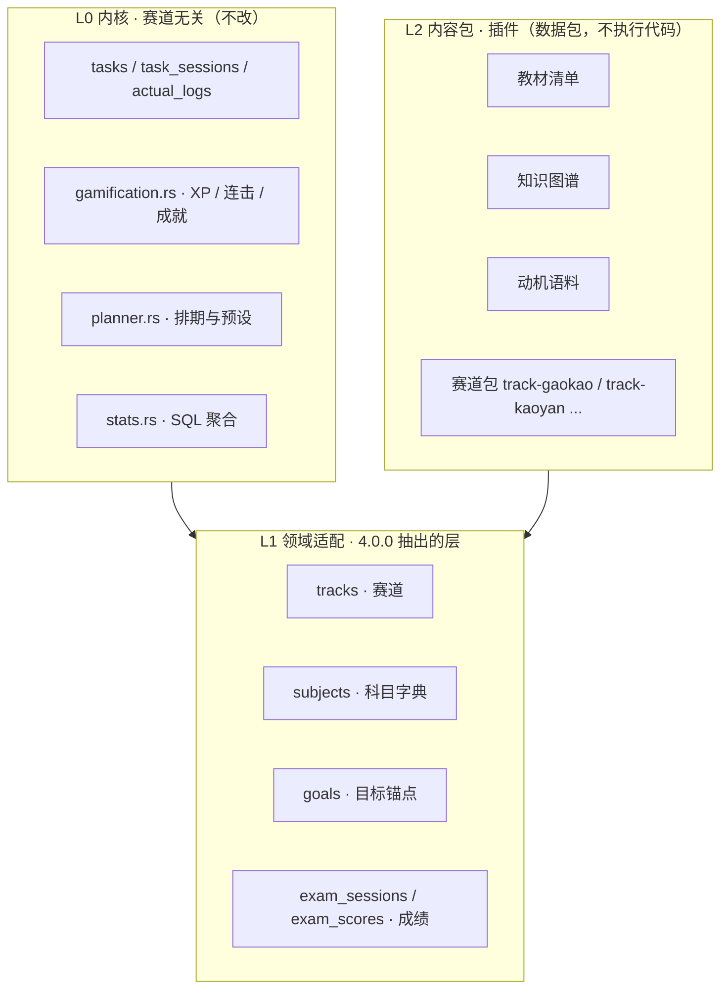

# TimeQuest — 目标倒计时 · 自习推进器 产品需求文档（PRD）

**产品名**：TimeQuest
**中文副标**：目标倒计时 · 自习推进器
**文档版本**：v2.0
**对应产品版本**：3.10.1（现状）→ 4.0.0（本次升级目标）
**形态**：Windows 桌面端轻量应用（Tauri 2 + React 19 + TypeScript + SQLite）
**定位**：单机、本地优先、无账号、**运行无网络依赖**的考试型自学闭环工具（Windows 安装 WebView2 引导程序时需联网；Win10 1803+ / Win11 已内置）
**核心闭环**：目标倒计时 → 任务/排期 → 完成/改期 → 标签统计 → 游戏化反馈 → 复盘

---

## 0. 文档说明

### 0.1 变更记录

| 文档版本 | 对应产品 | 主要变更 |
|---|---|---|
| v1.0 | 1.x – 2.0 | 初版：看板/任务/排期/完成流程/统计/便签/游戏化/设置 |
| v2.0 | 3.10.1 → 4.0.0 | ① 补全 2.0 – 3.10 已实现但未入文档的功能（M10 – M13）② 定位由「高考专属」泛化为「考试型自学者通用」，新增 M14 目标与档案管理 ③ 补入 §5.5 赛道化数据模型与迁移策略 ④ 补入 §9.6 兼容性与迁移非功能需求 |

### 0.2 文档定位

本文档是**产品与架构的需求源**。开发新功能或集成模块前必须先更新本文档并定稿方案，再开始编码（见 `AGENTS.md`「需求文档先行开发流程」）。

文档编号约定：`M<n>-<k>` 为功能需求编号；每条需求必须给出**验收口径**；涉及表结构的改动必须同步 §5 数据模型与 §5.4 迁移策略。

### 0.3 与 AGENTS.md 的关系

本文档 §3 设计原则、§6 架构约定、§7 命名规范与 `AGENTS.md` 保持同源。`AGENTS.md` 的测试清单随本文档需求同步增删。

---

## 1. 项目目标与边界

### 1.1 要解决的问题

考试型自学者（高考、考研、自考、成人教育、各类职业考证、语言考试）同时面对四件事：**时间压力（目标倒计时）、计划安排（作息/任务）、实际执行记录、自我评估**。现有工具要么只做倒计时，要么只做标签化时间记录，要么只做待办，数据割裂，无法回答“我的计划 vs 实际差在哪、效率如何”。

更棘手的是：不同考试方向的**科目、满分、计分口径、教材体系完全不同**，但用户对「排期—完成—复盘」的诉求是一致的。现有工具普遍把学科结构写死在代码或表结构里（固定科目列、固定总分），换方向就得重做。

### 1.2 产品目标

TimeQuest 用一个本地桌面应用，把“目标看板 + 任务进度 + 时段排期 + 实际记录 + 统计 + 轻游戏化”整合在同一个数据模型里，让用户每天打开就能看到：**离目标还有多久、今天该做什么、做了多少、和计划差多少、下一步怎么调**。

同时，**内核保持赛道无关**：排期、完成、改期、XP、连击、统计这些能力只依赖「任务 / 场次 / 流水」三张表，不感知学科与考试；学科结构、计分口径、目标日期全部下沉为可配置数据（§5.5）。

### 1.3 目标用户分层

| 层级 | 人群 | 复用内核比例 | 依赖内容包 |
|---|---|---|---|
| **核心** | 高三 / 高二自学学生 | 100% | 内置「高考」赛道包 + 人教版教材库 + 中小学知识图谱 |
| **扩展** | 考研 / 专升本 / 自考 / 成人教育 | ≈90% | 需新增赛道包（科目 + 目标 + 语料） |
| **扩展** | 雅思 / 托福 / 语言学习 | ≈85% | 需赛道包 + 非整数分数量表支持 |
| **扩展** | 职业考证（CPA / 教资 / 法考） | ≈85% | 需赛道包 + 及格制口径 |
| **潜在** | 技能习得（编程、乐器等） | ≈70% | 需赛道包 + 「里程碑」目标类型 |

**第一阶段（4.0.0）不追求覆盖全部人群**，目标是让「换一个考试方向」从「不可行」变成「装一个赛道包即可」。

### 1.4 明确不做

- 不做云同步、账号体系、排行榜、社交
- 不做复杂甘特图、项目管理级依赖关系
- 不做惩罚性机制（掉级、扣血、断连击清零历史）
- 不做富文本便签（纯文本，富文本后续迭代）
- 不做移动端（只做 Windows 桌面；架构上不排斥后续 Tauri 移动端）
- **不做多语言（i18n）**：4.0.0 不引入文案 key 化，文案仍为简体中文硬编码；理由见 §11 风险表
- **不做插件执行代码**：插件定位为「数据包」，不引入脚本引擎（安全与维护成本，§11）

---

## 2. 用户与核心场景

### 2.1 目标用户

有明确截止日期与成绩目标、需要自己安排每日学习的自学者。默认模板对应高三学生，但产品行为由赛道配置决定。

### 2.2 核心场景（赛道无关）

1. **早晨打开**：看到目标倒计时、今日排期时间轴、昨日未完成项。
2. **学习一个时段后**：点「完成」，填实际进度与自评；或点「改期」，把没做的挪到晚上/明天。
3. **晚上复盘**：看今日计划达成率、各科目实际投入 vs 计划、连击状态。
4. **周复盘**：看本周各科目/学习方式的分钟统计、达成率、平均自评、成就解锁。
5. **临时想法**：在便签墙写一张彩色便签，置顶提醒自己。
6. **考前冲刺**：看目标差距、总分/分科得分趋势、模拟考折算。

### 2.3 扩展场景（4.0.0 目标）

7. **首次启动选方向**：向导第一步选择赛道模板（高考 / 考研 / 语言 / 技能 / 自定义），第二步填目标日期与科目；不再强制填写「年级 + 省份 + 1–750 目标分」。
8. **中途换方向**：设置里可新增赛道包，同一份历史记录按科目归属继续可用。

---

## 3. 核心设计原则

1. **进度唯一真相**：任务进度 = `sum(actual_units)`，不单独维护 completed 字段，避免改期/补记对不上。
2. **改期不是失败**：改期保留原记录并标 `rescheduled`，历史可追溯；达成率统计包含改期，不粉饰数据。
3. **奖励真实推进**：XP 只与 `actual_units` 挂钩，不与“打开弹窗/点按钮”挂钩；自评只做小幅乘数，防止虚报。
4. **正向驱动，不制造焦虑**：无惩罚性机制；改期恢复有额外奖励；连击断掉只重置倍率，不清历史。
5. **数据本地可控**：SQLite 单文件，支持导出/导入，用户随时可带走数据。
6. **配置驱动，内核不知赛道**（4.0.0 新增）：`tasks / task_sessions / actual_logs` 三张核心表与 XP、连击、统计逻辑**不得出现任何学科、考试、年级、满分常量**。学科结构、目标、计分口径一律由 `tracks / subjects / goals` 提供数据。
7. **领域词下沉为数据**（4.0.0 新增）：凡「科目名 / 满分 / 目标日期 / 教材版本 / 知识点分级」这类会因赛道而异的内容，都必须来自配置或插件资源，代码里只保留通用默认值作为兜底。

---

## 4. 功能需求

### M1. 目标倒计时看板

| 编号 | 需求 | 说明 |
|---|---|---|
| M1-1 | 目标设置 | 支持多个目标（主目标 + 模考 / 里程碑），主看板显示当前主目标；目标名称由用户自定义，默认值来自赛道包 |
| M1-2 | 多粒度倒计时 | 显示剩余总天数、周数、月数，以及时/分/秒实时倒计时 |
| M1-3 | 看板常驻 | 窗口可置顶；关闭时最小化到托盘而非退出（可设置） |
| M1-4 | 防误关 | 关闭按钮可配置为“最小化到托盘”，托盘菜单提供退出 |
| M1-5 | 性能 | 秒级刷新使用单一 interval，组件卸载清理，避免内存泄漏 |
| M1-6 | 三层时间透视 | 宏观目标倒计时 / 中观今日待学时长 / 微观当前场次倒计时同屏展示 |

**验收**：修改目标日期后看板立即更新；跨天/跨秒无跳变错误；连续运行 24h 内存无明显增长。

---

### M2. 任务管理（主线 / 副本）

**概念模型**：

- **任务（Task）** 承载“总量、课本、轮次、进度”，是长期存在的实体。
- **排期（Session）** 承载“某天某时段做这个任务的多少课”，是任务在时间轴上的实例。

| 编号 | 需求 | 说明 |
|---|---|---|
| M2-1 | 创建主线任务 | 字段：标题、科目、课本名、计量单位（课/章/节/章）、总课数、总轮次、颜色 |
| M2-2 | 创建副本任务 | 字段：标题、颜色；总课数/课本可空，进度条隐藏，只显示累计时长与完成次数 |
| M2-3 | 任务列表 | 主线/副本分组卡片；显示进度环（本轮课数进度 + 总轮次进度） |
| M2-4 | 任务详情 | 课本信息、当前轮次、进度、全部 session 历史（按状态着色）、考点列表 |
| M2-5 | 轮次推进 | 当前轮次手动推进；session 带 `round` 字段；详情页按轮次分组展示 |
| M2-6 | 搁置 | 任务可搁置（冻结），暂时不学不丢位置；搁置任务不参与自动排期 |
| M2-7 | 编辑 | 详情页可改标题/科目/课本/总课数/总轮次；只传改动字段，未传字段保持原值 |
| M2-8 | 回收站 | 删除先进回收站（`deleted_at`），排期与记录原样保留，可恢复；可二次确认后彻底清除；回收站任务禁止排期、推进轮次、搁置 |
| M2-9 | 网格视图 | 任务卡片可切「网格视图」，以点阵显示总课数进度（每格代表固定课数，最多 50 格） |

**验收**：新建任务后可在排期中选择；任务进度随 session 完成实时更新；搁置/归档任务不影响历史统计；回收站任务被拦下时给出原因说明。

---

### M3. 排期与今日计划

| 编号 | 需求 | 说明 |
|---|---|---|
| M3-1 | 创建排期 | 选任务、日期、开始/结束时间、轮次（默认任务当前轮）、本次计划课数 |
| M3-2 | 今日时间轴 | 按时间排序展示当天所有 session，主线/副本科目标色区分 |
| M3-3 | 冲突提示 | 同一时段重叠时给出非阻塞提示，不强制阻止 |
| M3-4 | 快速操作 | 每张卡片提供“完成 ✓”和“改期 ↻”两个主操作 |
| M3-5 | 空状态 | 今日无排期时展示引导创建 |
| M3-6 | 每日计划设置 | 可用时段 + 每日学习上限；“今日剩余待学”与周计划共用同一口径 |
| M3-7 | 自动排期 | 启动时按今天空出来的时段为主线任务幂等排期；设置里可开关；重复启动不重复排；回收站任务不占位 |
| M3-8 | 一键周计划 | 按每日可用时段 + 每日上限自动铺排 N 天；重复执行不重复排；被占用/超限的格子如实报告跳过数 |

**验收**：创建排期后今日页立即出现；时间轴排序正确；改期后原卡片状态更新；自动排期在重复启动下幂等。

---

### M4. 完成与改期流程（核心交互）

**三种真实场景，弹窗要区分：**

| 场景 | 触发 | 弹窗内容 | 系统行为 |
|---|---|---|---|
| ① 完全完成 | 点“完成” | 实际课数（默认=计划课数）、1–5 星自评、可选备注 | session → `done`；写 `actual_logs` 学习流水；计算 XP |
| ② 部分完成 | 点“完成”且实际课数 < 计划 | 同上 + 勾选“剩余改到下次” | 原 session → `done`；剩余课数生成新 `planned` session 放到用户选的时间 |
| ③ 完全没做 / 整体改期 | 点“改期” | 只选新日期时段 | 原 session → `rescheduled` 并记录 `rescheduled_to` 指向新 session |

**约束**：

- 完成提交必须**幂等**：若 session 已是 `done`，不重复写流水、不重复加 XP。
- 改期**不删除**原记录。
- 部分完成的“剩余改到下次”生成的新 session 继承原任务的轮次和科目。
- `actual_units = 0` 且勾选「剩余改到下次」时**拒绝提交**并提示改期（不产生流水/XP/连击变更）。
- 时长按 session 时段差计算；零长时段记 1 分钟。

**验收**：三种场景各自产生正确状态；重复点击完成不产生重复流水；改期后历史可见且达成率统计正确。

---

### M5. 标签化时间记录与统计

**标签维度**：`subject`（科目，开放字符串）+ `method`（学习方式）+ `tag_type`（学习/运动/游戏/其他）。完成 session 时自动写入 `actual_logs`；也支持手动补记（不绑定 session）。

| 编号 | 需求 | 说明 |
|---|---|---|
| M5-1 | 快速记录 | 只要求选标签 + 可选开始时间，结束时间可后补；时长在 Rust 侧算好存 `duration_min` |
| M5-2 | 计划 vs 实际 | 按周/月切换，每个科目计划总分钟 vs 实际总分钟，并排条形图 |
| M5-3 | 学习方式占比 | 各学习方式的实际分钟占比；分母只含 `tag_type='study'` |
| M5-4 | 运动/游戏 | 单独按 `tag_type` 汇总，不计入学习效率 |
| M5-5 | 计划达成率 | `done / (done + missed + rescheduled)`，按周/月 |
| M5-6 | 平均自评 | 按科目/任务聚合自评星级均值 |
| M5-7 | 区间边界 | 自然周（周一起）/ 自然月闭区间；按 session/流水日期过滤，不用墙钟时间 |
| M5-8 | 未知维度不丢 | 自定义科目 / 未知学习方式照常进统计，不归「其他」、不丢弃 |

**实现约束**：统计查询尽量写在 SQL / Rust command 中，前端只渲染，不拉全量数组在前端 filter。

**验收**：切换周/月数据正确；计划为 0 时不出现除零错误；运动/游戏不计入学习效率分母；空数据时图表显示空态而非崩溃。

---

### M6. 多颜色便签墙

| 编号 | 需求 | 说明 |
|---|---|---|
| M6-1 | 创建便签 | 纯文本内容 + 6 种预设颜色 |
| M6-2 | 置顶 | 置顶便签排在前面，视觉上有标记 |
| M6-3 | 编辑/删除 | 就地编辑，删除需确认 |
| M6-4 | 排序 | 默认按更新时间倒序；置顶优先；同组按 id 倒序保证稳定 |
| M6-5 | 绑定日期 | 便签可绑定日期，「今日」页汇总当天备忘 |
| M6-6 | 渲染策略 | 一次全量渲染 + 卡片 `memo`；置顶切换只重建被点的那张 |

**验收**：颜色映射为 Tailwind 类名，不引入复杂主题系统；便签数据持久化在 SQLite；滚动不触发二次拉取。

---

### M7. 游戏化系统

**基调**：正向进度感驱动，无惩罚。XP 只奖励 `actual_units`，不奖励“打开弹窗”。

#### 7.1 XP 规则

```
单次 session XP = actual_units × 基础单位XP × 质量乘数 × 连击乘数
```

- 基础单位 XP：主线略高于副本（12 : 10）。
- 质量乘数：自评 4–5 星 ×1.2，3 星 ×1.0，1–2 星 ×0.9（小幅，防虚报）。
- 连击乘数：见 7.2。
- `actual_units = 0` 时 XP = 0。
- 改期后在新时段完成：额外一笔 `reschedule_recovery_bonus`（5 XP）。

#### 7.2 连击（Streak）

- 定义：连续 N 天至少有一个 `done` session。
- 倍率随连击天数阶梯提升（3 天 ×1.1，7 天 ×1.2，14 天 ×1.3，30 天及以上 ×1.5）。
- 断连击只重置倍率为 1，**不清零历史最长连击记录**。
- 补记更早日期不得倒退 streak / last_done_date。

#### 7.3 等级

- 等级曲线递增：`XP_req(level) = 100 × level^1.5`。
- 等级只做展示与成就解锁条件，不附带数值惩罚/限制。

#### 7.4 成就（行为模式类，非数值堆砌）

| 成就 | 条件 |
|---|---|
| 首轮完成 | 某主线任务**当前轮** `sum(actual_units) >= total_units`（历史轮不并入） |
| 逆风翻盘 | 一个 `rescheduled` session 在新时段完成且自评 ≥4 星 |
| 均衡发展 | 一周内主线和副本都有 `done` 记录 |
| 持续在场 | 连续 5 天有 `done` session（断掉只重置倍率，成就保留） |

成就解锁只记录 + 触发 Toast，**不额外给大额 XP**。解锁判定必须幂等（同一成就只写入一行）。

#### 7.5 前端组件

- 成就 Toast 只在重要里程碑触发，不每次完成都弹；配套烟花 / 音效庆祝。
- 改期弹窗用中性色调，文案强调“重新安排也是计划的一部分”。

**验收**：XP 计算为纯函数且有单测；重复提交不重复加 XP；连击跨天判断正确（本地时区）。

---

### M8. 设置与数据管理

| 编号 | 需求 | 说明 |
|---|---|---|
| M8-1 | 目标管理 | 主目标 + 多目标切换（4.0.0 起目标落库，见 M14） |
| M8-2 | 托盘行为 | 关闭最小化/退出可选 |
| M8-3 | 数据导出 | 导出 JSON，文件名 `timequest-backup-YYYYMMDD.json` |
| M8-4 | 数据导入 | 导入前自动备份当前 DB 并确认；导入失败整单回滚，不得半清空 |
| M8-5 | 主题 | 深色为主，与倒计时看板协调 |
| M8-6 | 用户档案 | 头像、年级/方向、地区、总分目标、各科目标（4.0.0 改为赛道与科目，见 M14） |
| M8-7 | 每日计划 | 可用时段、每日上限、自动排期开关 |
| M8-8 | 常用时段/时长预设 | 编辑预设后可批量把今天及以后命中的场次挪走/改时长；撞车的保持原样并如实报告有几场没挪动 |
| M8-9 | 数据管理 | 演示数据单独标记，可一键清除而不影响真实记录 |

**验收**：导出/导入往返后行数、关联关系、可空字段、时间戳保持一致；导入后 `PRAGMA foreign_key_check` 无违规。

---

### M9. 工具箱与插件

**概念模型**：

- **工具箱（Toolbox）** 收纳内置工具（如错题本）与可下载的插件。
- **插件（Plugin）** 是**数据包**：自带清单 + 资源文件（教材清单、知识图谱、语料包等），**不执行代码**。

| 编号 | 需求 | 说明 |
|---|---|---|
| M9-1 | 工具箱菜单 | 侧边栏新增「工具箱」直达页；点开是工具图标网格 |
| M9-2 | 内置工具 | 网格里以图标格展示内置工具（错题本），点图标才进入该工具 |
| M9-3 | 插件仓库 | 网格里以图标格展示插件清单（名称、简介、作者、版本、大小与能力说明） |
| M9-4 | 下载安装 | 进入插件详情页点「下载并安装」，把插件包落到 `appData/plugins/<id>/plugin.json` 并登记；重复下载不重复登记 |
| M9-5 | 卸载 | 卸载删除本地目录并取消登记；未安装时卸载也算成功 |
| M9-6 | 插件选项 | 插件可声明可配置项（text/number/bool/select），未设置时取默认值，改完写进 `plugin.<id>.<key>` |
| M9-7 | 插件资源 | 插件可自带资源文件，安装时解包到插件目录；资源路径必须是安全的相对路径 |
| M9-8 | 资源类型 | 支持 `file` / `textbook_catalog` / `knowledge_graph` 三类 |
| M9-9 | 赛道包 | 4.0.0 新增：插件可声明 `kind: "track"`，安装即插入赛道/科目/目标种子行（见 M14-5） |

**约束**：插件**不新增数据库表**；安装状态登记在 `app_settings`，不影响导出/导入的数据表清单。

---

### M10. 教材导入与任务矩阵（v2.0 – v3.6）

| 编号 | 需求 | 说明 |
|---|---|---|
| M10-1 | 内置教材目录 | 内置 35 册教材目录（语文/数学/英语/物理/化学/生物，人教为主 + 湘教数学），可按科目 Tab 浏览 |
| M10-2 | 教材清单插件 | 工具箱「中小学教材库」插件：按学段/科目/版本浏览教材清单快照，只下载需要的那一本 PDF |
| M10-3 | 断点续传 | 下载支持断点续传；首选源不通时切备用源；两个源指向同一 commit，字节一致，换源续传不拼坏文件 |
| M10-4 | PDF 目录解析 | 下载完成后自动解析 PDF 目录，提取章节 / 小节 / 考点 |
| M10-5 | 生成任务矩阵 | 勾选小节生成主线任务（总课数 = 小节数），可选自动排期 |
| M10-6 | 导入教材 | 用户自备 PDF 导入目录，替换/新增对应课本大纲 |
| M10-7 | 考点勾选 | 一键勾选标准考点，也可手动补自定义考点 |

---

### M11. 错题本与知识图谱（v3.6 – v3.8）

| 编号 | 需求 | 说明 |
|---|---|---|
| M11-1 | 错题本 | 内置于工具箱；字段：科目、题目简述、错因分类、正确思路、是否订正 |
| M11-2 | 错因白名单 | 闭合集合，前端与后端白名单必须一致；未知错因归「其他」 |
| M11-3 | 筛选与统计 | 未订正/已订正筛选；按错因分布统计 |
| M11-4 | 知识图谱插件 | 「中小学知识图谱」插件：内置数学 870 点 + 物理 269 点及其先修关系，其余学科按需下载并本地缓存 |
| M11-5 | 知识图谱浏览 | 按学段/册次浏览、搜索、查看每个考点的掌握标准与诊断题 |
| M11-6 | 考点挂载 | 图谱知识点可加入任务考点，带「图谱」徽标，同一考点不重复加入 |
| M11-7 | 先修关系图 | 单个知识点的局部前置关系图，硬门槛实线 / 软边虚线，深层前置折叠 |
| M11-8 | 排期建议 | 先修考点未学完却排在了后面时，任务详情页给出提醒 |
| M11-9 | 错题与图谱互通 | 错题可挂图谱知识点；图谱节点显示「我在这里错过」；双向跳转；同一 id 在任务考点/图谱/错题本指同一件事 |
| M11-10 | 归属声明 | 知识图谱数据来自开源项目 cn-math-taxonomy，遵循 CC BY-NC 4.0，界面必须署名 |

---

### M12. 专注模式与桌面悬浮窗（v2.0+）

| 编号 | 需求 | 说明 |
|---|---|---|
| M12-1 | 番茄钟 | 从今日计划或悬浮窗进入专注计时，结束后可直接完成该场 |
| M12-2 | 白噪音 / 防休眠 | 专注期间可开白噪音、阻止系统休眠 |
| M12-3 | 课前提醒 | 开课前 5 分钟提醒 + 开课提醒，各触发一次 |
| M12-4 | 悬浮窗 | 桌面置顶显示目标倒计时与当前场次；可拖拽、可关闭 |
| M12-5 | 悬浮窗开关 | 设置项可开关，窗口 label 为 `widget` 时只渲染悬浮窗页面，不挂侧边栏 |

---

### M13. 计划视图与复盘（v3.9 – v3.10）

| 编号 | 需求 | 说明 |
|---|---|---|
| M13-1 | 多视图 | 总计划页支持列表 / 网格 / 日历 / 甘特 / 鱼骨五种视图，配合学科/课本/轮次筛选 |
| M13-2 | 视图切换 | 切换视图时卸载上一视图组件，不重复拉取任务列表 |
| M13-3 | 冲刺航线 | 把主线进度收成一条可跟随的航线 |
| M13-4 | 复盘报告 | 按本周/本月生成可复制的学习总结 |
| M13-5 | 每日自动备份 | 启动时备份 `timequest.db`，保留最近 7 份 |
| M13-6 | 模考倒计时 | 除主目标外还能盯住下一次模考 |
| M13-7 | 术语表 | 界面上遇到「XP」「等级」「达成率」等词就地可查解释 |

---

### M14. 目标与档案管理（v4.0 升级核心）

> 本模块是 4.0.0 的主体。目标是**把「高考」从代码里降级为一个默认赛道模板**，让内核完全赛道无关。

#### M14-1 目标（Goals）落库

**现状问题**：目标（主考日、模考日）当前存于前端 `localStorage` 的 `timequest.exams`，**不在 SQLite**，因此 `export_json` 导不出、导入恢复不了、换机即丢。

| 编号 | 需求 | 说明 |
|---|---|---|
| M14-1-1 | 新增 `goals` 表 | 字段见 §5.5；主目标唯一（`is_primary`），支持 `kind` 区分考试 / 里程碑 / 截止日 |
| M14-1-2 | 目标 CRUD | Tauri command 提供 list / upsert / remove / set_primary |
| M14-1-3 | 前端改造 | `store/ui.ts` 的 `exams` 改为 React Query + `goals` 表；`localStorage` 仅保留一次性迁移读取 |
| M14-1-4 | 一次性迁移 | 首次升级时把 `localStorage` 中的旧目标迁进 `goals` 表，迁移成功后清除该 localStorage key |
| M14-1-5 | 统一读取 | 看板、设置页、悬浮窗、复盘报告统一读 `goals`，不再各自持有副本 |
| M14-1-6 | 导出导入 | 导出 payload 含 `goals`；导入后目标不丢；旧 payload 无 `goals` 时回落为种子默认目标 |

#### M14-2 赛道（Tracks）与科目（Subjects）

| 编号 | 需求 | 说明 |
|---|---|---|
| M14-2-1 | 新增 `tracks` 表 | 一条赛道 = 一个学习方向（高考 / 考研 / 雅思 / 技能）；字段见 §5.5 |
| M14-2-2 | 新增 `subjects` 表 | 科目字典，取代 `user_profile.subject_targets` 的固定六键 JSON |
| M14-2-3 | 科目迁移 | 旧 `subject_targets` 的六键迁为 6 行 `subjects`，挂到默认赛道 |
| M14-2-4 | 科目增删改 | 设置页可增删科目、改名、改满分、改目标值、改计量单位 |
| M14-2-5 | 满分可空 | `full_mark` 可为 NULL，表示「无满分概念」（语言 band、技能进度） |
| M14-2-6 | 领域字段收敛 | `grade`、`region`（年级 / 省份）仅在赛道模板声明 `requires_gaokao_context` 时才呈现；否则不显示 |
| M14-2-7 | 内核解耦 | `tasks.subject`、`actual_logs.subject`、`mistakes.subject` 保持开放字符串，不做白名单校验 |

#### M14-3 成绩行化与计分参数化

| 编号 | 需求 | 说明 |
|---|---|---|
| M14-3-1 | 表拆分 | `exam_records` 拆为 `exam_sessions`（场次：名称 + 日期）与 `exam_scores`（每场每科一行） |
| M14-3-2 | 分数类型 | `score` 改 REAL，支持 6.5（雅思）、72.5 等非整数 |
| M14-3-3 | 折算参数化 | `TOTAL_FULL_MARKS = 610` 常量改为 `Σ subjects.full_mark`；六科配置下折算结果必须与现状完全一致 |
| M14-3-4 | 旧数据迁移 | 迁移脚本把旧 6 列展开成 6 行 `exam_scores`，并建出默认赛道与 6 个科目 |
| M14-3-5 | 旧备份兼容 | 导入旧 payload（`exam_records` 六列）时映射为默认赛道 + 6 个科目 + 成绩行，导入仍返回 Ok |
| M14-3-6 | 缺失科目语义 | NULL = 该场没考这门，不是 0 分；折算时按已考科目满分和折算 |

#### M14-4 引导与文案解耦

| 编号 | 需求 | 说明 |
|---|---|---|
| M14-4-1 | 向导改造 | 首次启动两步：① 选赛道模板（高考 / 考研 / 语言 / 技能 / 自定义）② 填目标日期、科目、目标值 |
| M14-4-2 | 删除硬编码 | 移除 `GRADES`（高一/高二/高三）、`PROVINCES`（34 省级行政区）、`DEFAULT_SUBJECT_TARGETS`（610 分六科） |
| M14-4-3 | 常量下沉 | `SUBJECTS` / `METHODS` / `DEFAULT_MOTIVATIONS` 改为「配置优先 + 中文默认值兜底」；动机语料按赛道可替换 |
| M14-4-4 | 副标通用化 | `APP_SUBTITLE` 改为「目标倒计时 · 自习推进器」；托盘 tooltip 用短副标 |
| M14-4-5 | 目标命名 | 界面不再出现固定「高考」字样，目标名一律读 `goals.name` / `tracks.name` |
| M14-4-6 | 向导兜底 | 自定义赛道时必填目标日期与至少一个科目；缺项给出明确提示 |

#### M14-5 赛道包（插件扩展）

| 编号 | 需求 | 说明 |
|---|---|---|
| M14-5-1 | manifest 扩展 | 插件清单新增 `kind: "track"` 与 `provides` 段（track / subjects / goals / motivation_pack / 教材 / 图谱） |
| M14-5-2 | 安装即播种 | 安装赛道包 = 插入 `tracks` / `subjects` / `goals` 种子行 + 解包资源；**仍不新增数据库表** |
| M14-5-3 | 内置高考包 | 内置 `track-gaokao` 赛道包（语文/数学/英语/物理/化学/生物 + 610 分口径 + 目标日期规则），保证现有用户升级后体验不退化 |
| M14-5-4 | 版本与作者 | 赛道包声明版本与作者，界面展示来源 |
| M14-5-5 | 卸载语义 | 卸载赛道包不删除已产生的历史记录，只是不再作为可选模板 |

#### M14-6 兼容与迁移要求

| 编号 | 需求 | 说明 |
|---|---|---|
| M14-6-1 | 体验不退化 | 现有用户升级后：引导流程、看板、成绩页、统计页行为与升级前一致 |
| M14-6-2 | 迁移幂等 | 迁移脚本重复执行结果一致，不重复插行、不重复建赛道 |
| M14-6-3 | 失败可回滚 | 迁移失败时 DB 保持可用，不留半成品；旧数据行数不变 |
| M14-6-4 | 导入导出对称 | 升级后导出的 payload 能被升级前的版本读懂（新增键可被忽略），升级后导入旧 payload 仍可用 |
| M14-6-5 | 内核零污染 | 升级后 `gamification.rs` / `planner.rs` / `sessions.rs` 完成事务 / `stats.rs` 中不得出现科目名、满分常量、年级、省份 |

---

## 5. 数据模型

### 5.1 现有表（v3.10.1 实际结构）

```sql
-- 任务
CREATE TABLE tasks (
  id            INTEGER PRIMARY KEY AUTOINCREMENT,
  title         TEXT NOT NULL,
  type          TEXT NOT NULL CHECK(type IN ('main','side')),
  subject       TEXT,
  textbook      TEXT,
  unit_name     TEXT DEFAULT '课',
  total_units   INTEGER,
  total_rounds  INTEGER DEFAULT 1,
  current_round INTEGER DEFAULT 1,
  color         TEXT,
  archived      INTEGER DEFAULT 0,
  is_mock       INTEGER DEFAULT 0,
  deleted_at    TEXT,
  created_at    TEXT NOT NULL DEFAULT (datetime('now','localtime'))
);

-- 排期实例
CREATE TABLE task_sessions (
  id              INTEGER PRIMARY KEY AUTOINCREMENT,
  task_id         INTEGER NOT NULL REFERENCES tasks(id),
  date            TEXT NOT NULL,
  start_time      TEXT NOT NULL,
  end_time        TEXT NOT NULL,
  round           INTEGER DEFAULT 1,
  status          TEXT NOT NULL DEFAULT 'planned'
                  CHECK(status IN ('planned','done','missed','rescheduled')),
  planned_units   INTEGER DEFAULT 0,
  actual_units    INTEGER DEFAULT 0,
  self_rating     INTEGER,
  self_note       TEXT,
  rescheduled_to  INTEGER REFERENCES task_sessions(id),
  xp_awarded      INTEGER DEFAULT 0,
  is_mock         INTEGER DEFAULT 0,
  created_at      TEXT NOT NULL DEFAULT (datetime('now','localtime'))
);

-- 实际学习流水（标签统计来源）
CREATE TABLE actual_logs (
  id           INTEGER PRIMARY KEY AUTOINCREMENT,
  date         TEXT NOT NULL,
  start_at     TEXT,
  end_at       TEXT,
  duration_min INTEGER NOT NULL,
  subject      TEXT,
  method       TEXT,
  tag_type     TEXT NOT NULL DEFAULT 'study'
               CHECK(tag_type IN ('study','sport','game','other')),
  session_id   INTEGER REFERENCES task_sessions(id),
  note         TEXT,
  created_at   TEXT NOT NULL DEFAULT (datetime('now','localtime'))
);

-- 便签
CREATE TABLE notes (
  id         INTEGER PRIMARY KEY AUTOINCREMENT,
  content    TEXT NOT NULL,
  color      TEXT NOT NULL DEFAULT 'yellow',
  pinned     INTEGER DEFAULT 0,
  note_date  TEXT,
  created_at TEXT NOT NULL DEFAULT (datetime('now','localtime')),
  updated_at TEXT NOT NULL DEFAULT (datetime('now','localtime'))
);

-- 错题
CREATE TABLE mistakes (
  id                INTEGER PRIMARY KEY AUTOINCREMENT,
  subject           TEXT NOT NULL DEFAULT '',
  title             TEXT NOT NULL,
  reason            TEXT NOT NULL DEFAULT '其他',
  correct_note      TEXT NOT NULL DEFAULT '',
  is_mastered       INTEGER DEFAULT 0,
  graph_topic_id    TEXT,
  graph_subject     TEXT,
  graph_topic_name  TEXT,
  created_at        TEXT NOT NULL DEFAULT (datetime('now','localtime')),
  updated_at        TEXT NOT NULL DEFAULT (datetime('now','localtime'))
);

-- 任务考点
CREATE TABLE task_knowledge_points (
  id             INTEGER PRIMARY KEY AUTOINCREMENT,
  task_id        INTEGER NOT NULL REFERENCES tasks(id),
  section_name   TEXT NOT NULL,
  name           TEXT NOT NULL,
  is_mastered    INTEGER DEFAULT 0,
  position       INTEGER DEFAULT 0,
  graph_topic_id TEXT,
  graph_subject  TEXT,
  created_at     TEXT NOT NULL DEFAULT (datetime('now','localtime'))
);

-- 导入的教材大纲
CREATE TABLE imported_textbooks (
  id           INTEGER PRIMARY KEY AUTOINCREMENT,
  subject      TEXT NOT NULL,
  version      TEXT NOT NULL,
  volume       TEXT NOT NULL,
  outline_json TEXT NOT NULL,
  created_at   TEXT NOT NULL DEFAULT (datetime('now','localtime')),
  updated_at   TEXT NOT NULL DEFAULT (datetime('now','localtime'))
);

-- 用户统计（单行）
CREATE TABLE user_stats (
  id               INTEGER PRIMARY KEY CHECK(id = 1),
  total_xp         INTEGER DEFAULT 0,
  current_level    INTEGER DEFAULT 1,
  current_streak   INTEGER DEFAULT 0,
  longest_streak   INTEGER DEFAULT 0,
  last_done_date   TEXT
);

-- 成就目录与解锁记录
CREATE TABLE achievements (
  id          TEXT PRIMARY KEY,
  name        TEXT NOT NULL,
  description TEXT
);
CREATE TABLE user_achievements (
  achievement_id TEXT PRIMARY KEY REFERENCES achievements(id),
  unlocked_at    TEXT NOT NULL DEFAULT (datetime('now','localtime'))
);

-- 应用设置（插件安装登记、插件选项等）
CREATE TABLE app_settings (
  key        TEXT PRIMARY KEY,
  value      TEXT NOT NULL,
  updated_at TEXT NOT NULL DEFAULT (datetime('now','localtime'))
);

-- 用户档案（单行）
CREATE TABLE user_profile (
  id               INTEGER PRIMARY KEY CHECK(id = 1),
  avatar           TEXT,
  grade            TEXT NOT NULL DEFAULT '高三',
  region           TEXT NOT NULL DEFAULT '',
  total_target     INTEGER NOT NULL DEFAULT 610,
  subject_targets  TEXT NOT NULL DEFAULT '{"chinese":120,"math":130,"english":120,"physics":80,"chemistry":80,"biology":80}',
  updated_at       TEXT NOT NULL DEFAULT (datetime('now','localtime'))
);

-- 成绩记录（4.0.0 将行化，见 §5.5）
CREATE TABLE exam_records (
  id              INTEGER PRIMARY KEY AUTOINCREMENT,
  exam_name       TEXT NOT NULL,
  exam_date       TEXT NOT NULL,
  chinese_score   INTEGER,
  math_score      INTEGER,
  english_score   INTEGER,
  physics_score   INTEGER,
  chemistry_score INTEGER,
  biology_score   INTEGER,
  created_at      TEXT NOT NULL DEFAULT (datetime('now','localtime'))
);
```

### 5.2 实体关系

```
tracks ──┬── subjects ──┬── exam_scores ── exam_sessions
         │              └── tasks (subject 为开放字符串，按名称关联)
         └── goals
```

`tasks / task_sessions / actual_logs` 不挂在任何赛道下 —— 它们是**全局**的，赛道只提供「科目字典 / 目标 / 满分口径」这层解释。

### 5.3 索引

```
task_sessions(date) / task_sessions(task_id)
actual_logs(date) / actual_logs(session_id)
exam_records(exam_date)
task_knowledge_points(task_id)
```

### 5.4 v4.0.0 新增表

```sql
-- 学习方向（赛道）
CREATE TABLE tracks (
  id          INTEGER PRIMARY KEY AUTOINCREMENT,
  name        TEXT NOT NULL,
  kind        TEXT NOT NULL DEFAULT 'exam'
              CHECK(kind IN ('exam','skill','course')),
  score_mode  TEXT NOT NULL DEFAULT 'total'
              CHECK(score_mode IN ('total','per_subject','band')),
  is_primary  INTEGER DEFAULT 0,
  color       TEXT,
  created_at  TEXT NOT NULL DEFAULT (datetime('now','localtime'))
);

-- 科目字典
CREATE TABLE subjects (
  id          INTEGER PRIMARY KEY AUTOINCREMENT,
  track_id    INTEGER NOT NULL REFERENCES tracks(id) ON DELETE CASCADE,
  key         TEXT NOT NULL,
  label       TEXT NOT NULL,
  full_mark   REAL,
  goal        REAL,
  unit        TEXT NOT NULL DEFAULT '课',
  order_index INTEGER NOT NULL DEFAULT 0,
  UNIQUE(track_id, key)
);

-- 目标（倒计时锚点）
CREATE TABLE goals (
  id           INTEGER PRIMARY KEY AUTOINCREMENT,
  track_id     INTEGER REFERENCES tracks(id),
  name         TEXT NOT NULL,
  date         TEXT NOT NULL,
  kind         TEXT NOT NULL DEFAULT 'exam'
               CHECK(kind IN ('exam','milestone','deadline')),
  is_primary   INTEGER DEFAULT 0,
  target_score REAL,
  created_at   TEXT NOT NULL DEFAULT (datetime('now','localtime'))
);

-- 考试场次（4.0.0 新增，取代 exam_records 的场次部分）
CREATE TABLE exam_sessions (
  id         INTEGER PRIMARY KEY AUTOINCREMENT,
  track_id   INTEGER REFERENCES tracks(id),
  name       TEXT NOT NULL,
  date       TEXT NOT NULL,
  created_at TEXT NOT NULL DEFAULT (datetime('now','localtime'))
);

-- 成绩行（4.0.0 新增，取代 exam_records 的六列）
CREATE TABLE exam_scores (
  id         INTEGER PRIMARY KEY AUTOINCREMENT,
  exam_id    INTEGER NOT NULL REFERENCES exam_sessions(id) ON DELETE CASCADE,
  subject_id INTEGER NOT NULL REFERENCES subjects(id),
  score      REAL,
  UNIQUE(exam_id, subject_id)
);

CREATE INDEX idx_subjects_track ON subjects(track_id);
CREATE INDEX idx_goals_track ON goals(track_id);
CREATE INDEX idx_exam_scores_exam ON exam_scores(exam_id);
CREATE INDEX idx_exam_sessions_date ON exam_sessions(date);
```

**设计要点**：

- `subjects.full_mark` 可空 → 同时支撑「总分制」（高考 610）与「无满分制」（雅思 band、技能进度）。
- `exam_scores.score` 用 REAL → 支持 6.5 / 72.5。
- `goals` 承载倒计时锚点 → 导出/导入覆盖，换机不丢（修复现状缺陷）。
- `tracks.score_mode` 预留 `total` / `per_subject` / `band` 三种计分口径；4.0.0 实现 `total` 与 `per_subject`，`band` 仅预留字段。

### 5.5 迁移策略

| 迁移 | 动作 | 幂等要求 |
|---|---|---|
| M-01 `create_tracks` | 建表 + 插入默认赛道「高考」 | 重复执行不重复插 |
| M-02 `create_subjects` | 建表；把 `user_profile.subject_targets` 六键展开为 6 行 | 重复执行不重复插 |
| M-03 `create_goals` | 建表；把 `localStorage` 旧目标迁入（前端一次性，读出即删 key） | 迁完清 key，不重复迁 |
| M-04 `split_exam_records` | 建 `exam_sessions` / `exam_scores`；旧 6 列展开成 6 行；保留旧表不删（只读留档） | 重复执行不重复插 |
| M-05 `profile_trim` | `user_profile` 的 `grade` / `region` / `total_target` / `subject_targets` 保留但不再作为权威来源（权威改为 `tracks` / `subjects` / `goals`） | 无数据变更 |

**迁移硬约束**：

1. 迁移在事务内执行；任一步失败整单回滚，旧数据行数不变。
2. 迁移后 `PRAGMA foreign_key_check` 必须为空。
3. 迁移前后 `export_json` 都能成功导出（导出器要同时兼容新旧 payload 形状）。
4. 旧 `exam_records` 表在 4.0.0 保留为只读留档，不做物理删除，避免不可逆。

### 5.6 导出 / 导入 payload

```json
{
  "version": 2,
  "exported_at": "<RFC3339>",
  "tracks": [...],
  "subjects": [...],
  "goals": [...],
  "exam_sessions": [...],
  "exam_scores": [...],
  "tasks": [...],
  "task_sessions": [...],
  "actual_logs": [...],
  "notes": [...],
  "mistakes": [...],
  "user_stats": {...},
  "user_achievements": [...],
  "user_profile": {...},
  "app_settings": {...},
  "imported_textbooks": [...],
  "task_knowledge_points": [...]
}
```

**兼容规则**：

- `version: 1`（旧 payload）导入时：缺 `tracks`/`subjects`/`goals` 时建默认高考赛道 + 六科目 + 种子目标；`exam_records` 六列映射为 `exam_sessions` + `exam_scores` 行。导入返回 Ok。
- `version: 2` 导入时：完整写入。
- 导出 `version` 常量升为 2；旧版读取器忽略未知键即可（保持向后兼容）。

---

## 6. 技术架构

### 6.1 分层



**约束**：L0 不得引用 L1 的具体值（科目名、满分、年级、省份）；L1 的值全部来自 L2 或用户输入。

### 6.2 技术选型

| 层 | 选型 | 职责 |
|---|---|---|
| 壳 | Tauri 2 | 窗口、托盘、置顶、打包、文件导入导出、桌面悬浮窗 |
| 前端 | React 19 + TypeScript + Vite | UI 与交互 |
| 样式 | Tailwind CSS 4 | 主题与布局 |
| 状态 | Zustand | UI 状态（当前页、弹窗、筛选） |
| 数据 | TanStack Query | 持久化数据读写与缓存 |
| 图表 | Recharts | 统计图 |
| 游戏化 UI | Questro + canvas-confetti | Combo Meter / Toast / Progress Rings / 庆祝 |
| 数据库 | SQLite（rusqlite） | 本地存储 |
| 业务逻辑 | Rust commands | 所有 SQL 读写、完成事务、时长计算 |
| 测试 | cargo test + vitest | 30 个 Rust 集成测试文件 + 前端单测 |

### 6.3 架构约定

- React **不直接**访问数据库文件，所有读写走 Tauri command。
- XP 计算、等级曲线、成就判定放在 `src/lib/gamification.ts` 纯函数 + `src-tauri/src/gamification.rs` 纯函数，附单测；完成路径的 XP / 连击 / 成就写在 `complete_session_impl` 事务内联逻辑中。
- 统计聚合写在 SQL / Rust，前端不拉全量数组 filter。
- 所有状态变更（完成/改期/部分完成）在 Rust command 中用事务保证一致性。
- **新增（4.0.0）**：领域词（科目 / 满分 / 年级 / 省份 / 目标日期）一律来自 `tracks / subjects / goals` 或插件资源，代码中只允许出现通用默认值兜底。
- **新增（4.0.0）**：插件仍是数据包，不引入脚本执行；赛道包通过「插种子行 + 解包资源」生效。

### 6.4 目录结构（4.0.0 目标）

```
src/
  pages/         Dashboard / Tasks / Today / Stats / Notes / Scores / Mistakes / Settings / Toolbox / Widget
  components/    通用 UI + 任务卡片 + 弹窗 + 完成弹窗 + 排期弹窗
  lib/           gamification.ts / track.ts / constants.ts / scoreScaling.ts / ...
  hooks/         useTracks / useSubjects / useGoals / useTasks / useSessions / useStats
  store/         zustand（仅 UI 偏好）
src-tauri/
  src/commands/  tracks.rs / subjects.rs / goals.rs / exams.rs / tasks.rs / sessions.rs / stats.rs ...
  src/           gamification.rs / plugins.rs / models.rs / db.rs
  migrations/    版本化 SQL 迁移
  resources/
    plugins/     *.json（插件清单）
    plugins/<id>/  插件资源
    tracks/      赛道包
```

---

## 7. 命名与品牌规范

### 7.1 基础命名

| 场景 | 写法 | 说明 |
|---|---|---|
| 产品名（展示） | **TimeQuest** | 英文主名，首字母大写，不拆成 Time Quest |
| 中文副标（4.0.0 起） | **目标倒计时 · 自习推进器** | 出现在标题栏、README 首行、关于页 |
| 完整署名 | **TimeQuest — 目标倒计时 · 自习推进器** | README 标题、安装包描述、关于页 |
| 仓库名 | `timequest` | 全小写，GitHub 仓库 |
| Tauri identifier | `com.timequest.desktop` | **权威在 `tauri.conf.json`；改它会换应用数据目录、丢用户旧数据** |
| 窗口标题 | `TimeQuest` | 副标放关于页，标题栏保持干净 |
| 托盘 tooltip | `TimeQuest · 目标倒计时` | 托盘空间有限，用短副标 |
| 数据库文件名 | `timequest.db` | 放在 Tauri appData 目录 |
| 导出文件名 | `timequest-backup-YYYYMMDD.json` | 便于识别 |
| 赛道包 id | `track-<slug>`，如 `track-gaokao` | 小写连字符 |
| 科目 key | 小写英文 slug，如 `chinese` / `ielts-writing` | 与 `label` 分离，label 可本地化 |

### 7.2 副标策略

- 副标是**产品级**的，不随赛道变化。
- 「高考」只作为**赛道名**出现在 `tracks.name` / `goals.name`，由用户或赛道包决定，代码中不写死。
- 历史文案里的「高考倒计时」在 4.0.0 统一替换为「目标倒计时」。

### 7.3 兼容策略

- 4.0.0 不做 i18n，但**代码中所有赛道相关文案集中到 `src/lib/track.ts` / 赛道包资源**，为后续 i18n 留出收口点。
- README 首行副标随 4.0.0 更新；旧版本 Release 描述不改。

### 7.4 一致性原则

代码里凡是出现产品名的地方，统一引用 `src/lib/constants.ts`：

```ts
export const APP_NAME = "TimeQuest";
export const APP_SUBTITLE = "目标倒计时 · 自习推进器";
export const APP_FULL_NAME = `${APP_NAME} — ${APP_SUBTITLE}`;
export const DB_FILE = "timequest.db";
```

---

## 8. 页面清单

| 页面 | 内容 |
|---|---|
| 倒计时看板（首页） | 目标倒计时、今日排期摘要、连击/等级状态条、冲刺航线 |
| 总计划 | 主线/副本分组卡片、五种视图（列表/网格/日历/甘特/鱼骨）、筛选 |
| 任务详情 | 进度环、session 历史、考点列表、编辑、搁置、先修建议 |
| 今日计划 | 时间轴、完成/改期入口、冲突提示、备忘汇总 |
| 专注 | 番茄钟、白噪音、防休眠 |
| 成绩 | 历次考试录入、总分与分科趋势、折算说明、目标差距 |
| 统计 | 计划 vs 实际、学习方式占比、达成率、平均自评，周/月切换 |
| 错题本 | 错题录入、错因分类、订正标记、挂知识点 |
| 工具箱 | 内置工具 + 插件图标网格、插件详情与选项 |
| 知识图谱 | 学科包浏览、知识点详情、局部先修图、「我在这里错过」 |
| 教材库 | 学段/科目/版本浏览、下载、目录解析、生成任务 |
| 便签墙 | 彩色便签、置顶、编辑、日期绑定 |
| 设置 | 目标与赛道、科目、档案、每日计划、预设、托盘、数据导入导出 |
| 悬浮窗 | 目标倒计时 + 当前场次 |

---

## 9. 非功能需求

### 9.1 性能
冷启动 < 2s；倒计时 tick 不影响页面交互；统计查询在 1 万条 session 量级下 < 200ms。

### 9.2 可靠性
完成/改期操作事务化；重复提交幂等；导入前自动备份；迁移失败整单回滚。

### 9.3 数据安全
全部本地存储，无网络请求（教材/图谱下载为用户显式触发）；导出文件明确提示包含个人学习数据。

### 9.4 可维护性
`gamification.ts` / `gamification.rs` 纯函数 + 单测；SQL 集中在 Rust command；表结构迁移有版本号；导出/导入双向往返有护栏测试。

### 9.5 可访问性
深色主题下对比度达标；关键操作有键盘可达路径（至少完成/改期）；时间/日期用专用输入控件，避免手填非法值。

### 9.6 兼容性与迁移（4.0.0 新增）

- 现有用户升级后功能与体验不退化（M14-6-1）。
- 迁移幂等，失败可回滚（§5.5）。
- 导出 payload 向后兼容：v2 payload 含 v1 全部键；导入 v1 payload 仍可用（§5.6）。
- 旧备份不被破坏：导入失败时当前库保持原状（已有 `import_failure_rolls_back_to_pre_import_state` 护栏）。
- 内核零污染：L0 模块不得出现赛道常量（M14-6-5）。

---

## 10. 升级开发阶段规划（v4.0.0）

> 顺序原则：**先补与赛道无关的债，再动领域层**。P0-1 修复的是当前所有用户都受影响的目标丢失问题，与赛道化解耦。

| 阶段 | 内容 | 完成标志 |
|---|---|---|
| **P0-1** | `goals` 表落库：目标从 localStorage 迁入 SQLite，看板/设置/悬浮窗统一读 `goals`，导出导入覆盖 | 目标改动后导出→导入不丢；旧 localStorage 目标自动迁入且 key 被清除 |
| **P0-2** | 文案与入口解耦：副标改通用；`Onboarding` 改为「选方向 + 填目标」；移除 `GRADES`/`PROVINCES` 硬依赖 | 现有用户引导流程不退化；界面无固定「高考」字样 |
| **P1-1** | `exam_records` 行化：`exam_sessions` + `exam_scores`；`scoreScaling` 参数化（Σ full_mark 替代 610） | 六科配置下折算结果与升级前完全一致；旧备份导入仍 Ok |
| **P1-2** | `tracks` / `subjects` 建表与迁移；`subject_targets` 迁为行；设置页支持科目增删改 | 旧用户六科自动迁出且可编辑；内核不再读 `subject_targets` |
| **P1-3** | 赛道模板化：`tracks` 接入引导与设置；内置 `track-gaokao`；内核零污染校验 | 内核模块 grep 不到学科名/满分常量 |
| **P2-1** | 赛道包（插件 `kind: "track"`）：manifest 扩展 + 安装播种 + 资源解包 | 加一个赛道包 = 加 JSON + build 脚本，不改主程序代码 |
| **P2-2** | 动机语料按赛道可替换；`METHODS` / `SUBJECTS` 配置优先 + 默认兜底 | 换赛道后语料与学习方式随之切换 |

**每阶段强制项**：

1. `cargo test --manifest-path src-tauri/Cargo.toml -- --nocapture` 全绿。
2. `pnpm test`（vitest）全绿。
3. 导出/导入双向往返测试新增对应断言（沿用 `export_import_test.rs` 现有护栏风格）。
4. 同步更新 `AGENTS.md` 测试清单（本表新增的测试名必须进清单）。
5. 版本号三端一致（`pnpm bump`），CHANGELOG 按项目规范更新。

---

## 11. 风险与取舍

| 风险 | 应对 |
|---|---|
| 游戏化诱导虚报/刷 XP | XP 只绑 `actual_units`；自评仅小幅乘数；完成提交幂等；不做排行榜 |
| 改期功能被滥用导致数据失真 | 保留 `rescheduled` 状态并计入达成率分母；改期恢复有奖励但不掩盖历史 |
| 统计查询随数据增长变慢 | 聚合下沉 SQL + 索引；必要时按周预聚合 |
| 功能膨胀 | 严格按本文档范围；i18n、多设备同步列入后续版本 |
| Tauri Rust 门槛 | 业务逻辑集中在少量 command；前端纯函数可单测 |
| 产品名商标风险 | `TimeQuest` 为英文通用词组，公开前查第 9/41 类商标；必要时用「TimeQuest 自习」做限定 |
| **赛道化导致现有用户降级** | 高考降级为**默认赛道模板**而非被删除；内置 `track-gaokao` 保证体验不退化；迁移幂等可回滚 |
| **赛道化引发 schema 大改，回归面广** | 分阶段推进，P0 不动领域表；P1 每次只动一张表并单独出迁移；每阶段全量回归 |
| **折算口径改写影响成绩页精度** | 公式不变、只换参数源；六科配置下结果必须逐位一致，用测试钉住 |
| **内核被领域词污染** | 加护栏：L0 模块不允许出现科目名/满分常量（可用测试或 grep 检查兜底） |
| **赛道包引入脚本执行风险** | 坚持「数据包」定位，不引入脚本引擎；资源路径做安全相对路径校验 |
| **i18n 提前投入导致范围蔓延** | 4.0.0 明确不做；只把赛道相关文案集中到单一收口点，为将来留路 |

---

## 12. 后续版本（不在 4.0.0 范围）

- 便签富文本 / 贴边吸附 / 托盘常驻
- 周报导出（PDF/图片）
- 多设备同步（需重新评估隐私与账号体系）
- 移动端（Tauri 2 跨端）
- i18n（文案 key 化）
- 更多赛道包（雅思、托福、考研、自考、技能习得）
- 知识图谱 `grade/stage/semester` 降级为通用 `tags`，以支持非 K12 分级
- 轨道制目标（多目标并行推进）

---

**文档使用说明**：本文件为仓库根目录 `PRD.md`；把第 3 节设计原则、第 6 节架构约定、第 7 节命名规范摘录到 `.cursor/rules` 与 `AGENTS.md`，作为长期上下文。开发新功能前先更新本文档。
