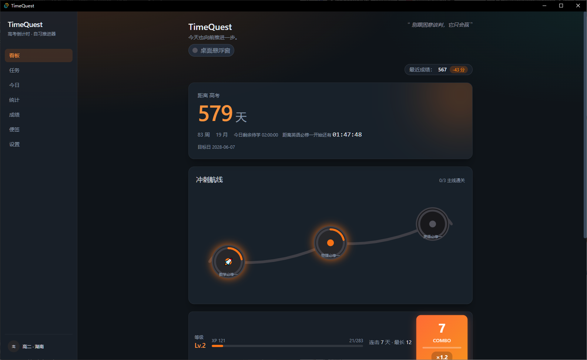
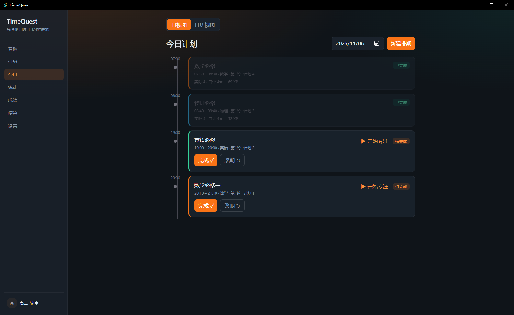
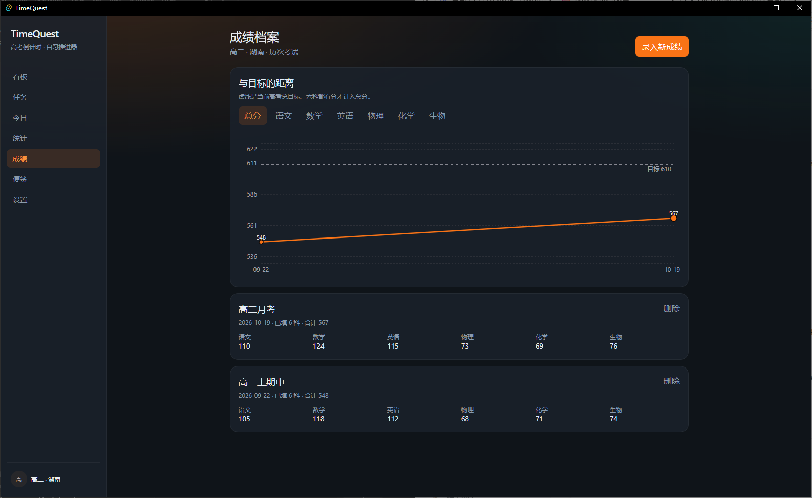
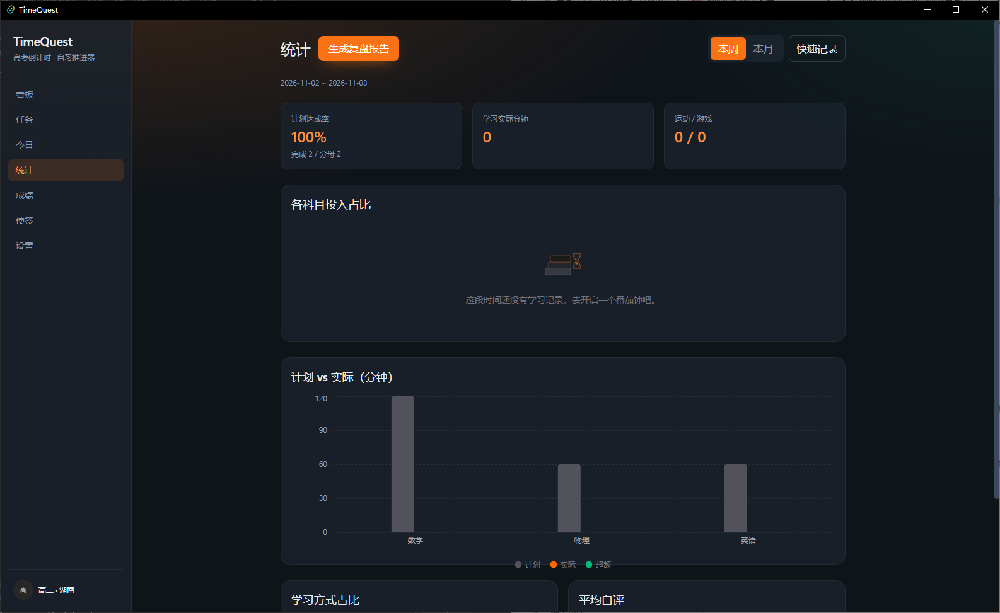

<p align="center">
  <a href="https://v2.tauri.app/"></a>
  <a href="https://react.dev/"></a>
  <a href="https://www.typescriptlang.org/"></a>
  <a href="https://www.sqlite.org/"></a>
  
</p>

<h1 align="center">TimeQuest</h1>

<p align="center">
  <strong>TimeQuest — 专为高考自学打造的全息时间与目标管理神器。本地优先，无账号，数据全在本地。</strong>
</p>

<p align="center">
  高考倒计时 · 自习推进器<br />
  当前版本 <strong>3.0.0</strong>
</p>

## 效果预览

<table>
  <tr>
    <td width="50%" align="center" valign="top">
      
      <br />
      <strong>看板</strong>
      <br />
      宏观倒计时与冲刺航线。
    </td>
    <td width="50%" align="center" valign="top">
      
      <br />
      <strong>今日</strong>
      <br />
      动态时间轴与专注状态。
    </td>
  </tr>
  <tr>
    <td width="50%" align="center" valign="top">
      
      <br />
      <strong>成绩</strong>
      <br />
      历次成绩与目标线对比。
    </td>
    <td width="50%" align="center" valign="top">
      
      <br />
      <strong>统计</strong>
      <br />
      计划与实际达成率统计。
    </td>
  </tr>
</table>

## 核心特性

- 🎯 **三层时间透视**：宏观高考天/周/月，中观今日待学时长，微观当前场次倒计时。
- 📚 **教材一键导入**：内置人教版/统编版全科目录，秒级生成学习任务矩阵。
- 🍅 **沉浸式专注**：桌面级番茄钟、白噪音、防休眠。
- 📈 **成绩追踪**：录入历次考试，可视化与目标分数的差距。
- 🗺️ **游戏化反馈**：XP 连击、微观点阵、冲刺航线。
- 📌 **桌面悬浮窗**：常驻桌面的高考倒计时与当前任务。

## 快速开始

### 下载安装

Windows 安装包在 [v3.0.0 Release](https://github.com/Ximencuishui/TimeQuest/releases/tag/v3.0.0)：

**[下载 TimeQuest 3.0.0（MSI）](https://github.com/Ximencuishui/TimeQuest/releases/download/v3.0.0/TimeQuest_3.0.0_x64_en-US.msi)**

系统需能使用 WebView2（Windows 11 已内置）。数据写在本机 `timequest.db`，不注册账号。

### 本地开发

需要 Node.js、[pnpm](https://pnpm.io/)、Rust stable。Windows 上还需要 MSVC 构建工具。

```bash
pnpm install
pnpm tauri dev
```

只看界面、不启桌面壳：

```bash
pnpm dev
```

打包安装程序：

```bash
pnpm tauri build
```

产物在 `src-tauri/target/release/bundle/`。

## 技术栈

界面是 React 19 与 TypeScript，桌面壳是 Tauri 2，业务事务在 Rust 里完成，状态落在单个 SQLite 文件。React 不直接打开数据库，读写都经过 Tauri command，完成、改期和部分完成放在同一事务里。安装包只带系统 WebView，不必捆一套浏览器。进度、经验和备份都留在本机，导出是一份 JSON，不经过账号或云端。
